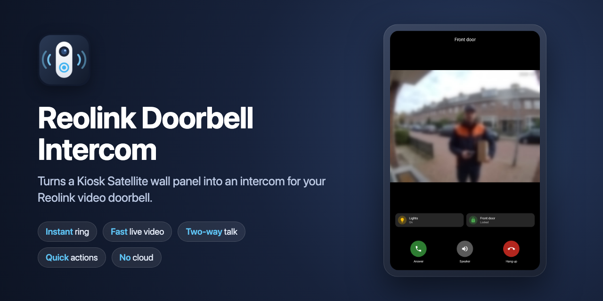
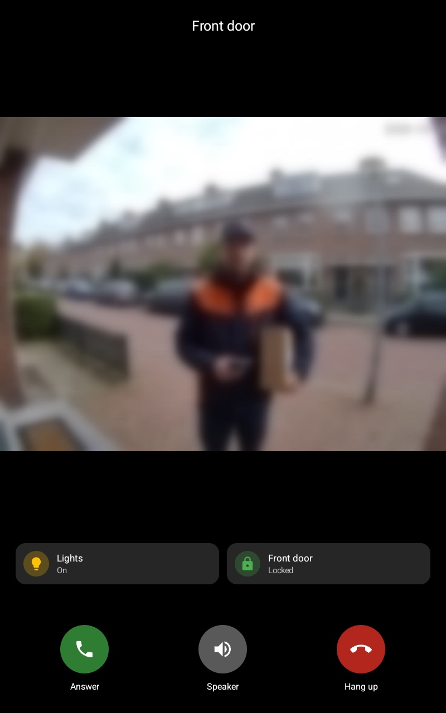
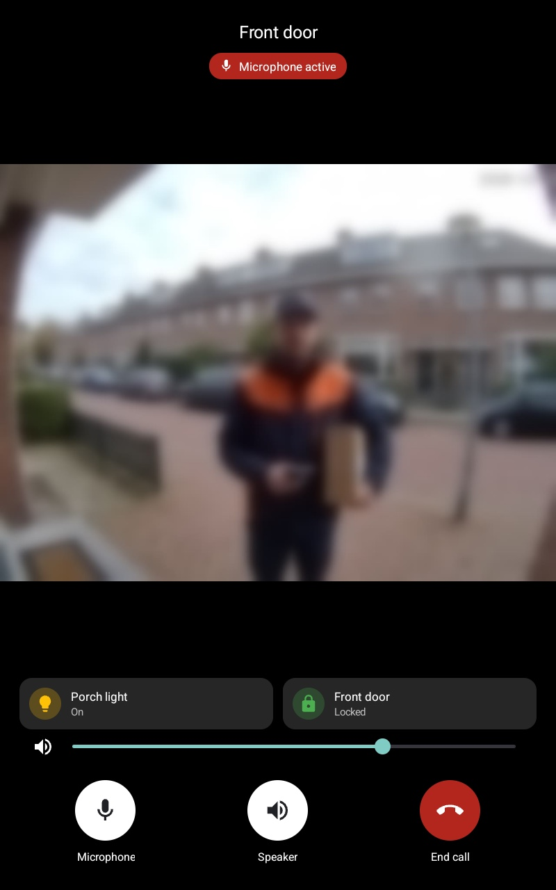
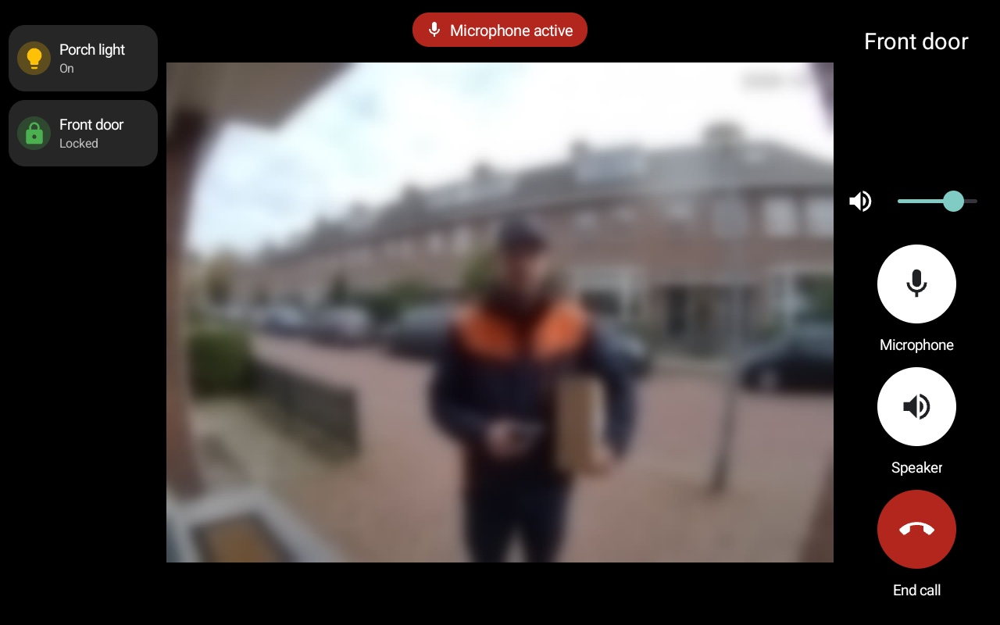

# Reolink Doorbell Intercom

<p align="center">
  
</p>

A [Kiosk Satellite](https://kiosksatellite.com) plugin that turns a wall panel into an intercom for a Reolink video doorbell. When someone presses the button, the panel rings at once and shows the doorbell's live video. You can listen in, and you can talk to the door.

The plugin talks to the doorbell directly on your own network. It needs no Home Assistant, go2rtc, Scrypted, cloud account or other server in between. Home Assistant only comes in when a quick action controls it or shows its state.

| Ringing | In a call | Landscape |
|:---:|:---:|:---:|
|  |  |  |

*The picture is blurred on purpose.*

*Not affiliated with or endorsed by Reolink or the Kiosk Satellite project. Reolink is a trademark of its owner.*

## Features

- **Rings at once.** The plugin keeps a connection open to the doorbell, so a press reaches the panel without delay. It wakes the screen, closes the screensaver, plays a soft chime and opens a full-screen call screen. Only the button rings: motion and person detection never do.
- **Live video.** H.264 straight from the doorbell, decoded in hardware. The plugin asks for the picture the way the Reolink app does, and the doorbell answers with a fresh keyframe at once: on a wall panel the first picture shows about 0.4 s after the press.
- **Listen, then answer.**
  - **Speaker** plays the sound at the door, with a volume slider on screen, since most panels have no volume buttons.
  - **Answer** opens the microphone so you can talk to the door. Your voice reaches the door in about 1 second, the same way the Reolink app talks.
  - During a call, **Microphone** and **Speaker** turn each side on and off, and **End call** hangs up.
- **Closes by itself** when nobody answers. A ring around **Hang up** shows the time left. A touch starts the time over, and Speaker or Answer stop it.
- **Open it any time** to look outside. Add the **Open** action to the kiosk menu, a gesture or Home Assistant. Opened by hand, it stays open until you close it.
- **Quick actions on the call screen.** Up to four cards above the call buttons, styled like Home Assistant's tiles. Each runs an action you pick with the same chooser as Gestures: a Home Assistant service or script, such as opening the door through a relay or toggling the lights, or anything else a gesture can do on the panel, such as opening a dashboard view. A card can also show the live state of a Home Assistant entity, such as a light or a lock. A card for a door or gate can ask to be held, so it never runs by accident.
- **Pauses the music** if you like: at the ring, or once you listen or talk, and resumes it afterwards.
- **Check button** on the settings page. It tests the address, the login, video and talking, and says what to fix.
- **English and Dutch** for the call screen and messages.

## Requirements

| | |
|---|---|
| **Doorbell** | A Reolink video doorbell on your local network, reachable from the panel. Tested with the **Reolink Video Doorbell PoE**, firmware v3.0.0.6460. Other Reolink doorbells that offer RTSP should work, but have not been tested. |
| **On the doorbell** | **RTSP** turned on, and preferably **ONVIF** too. In the Reolink app, go to Settings > Network > Advanced > Server Settings. Video and talking go over Reolink's own protocol (Baichuan, port 9000); RTSP and ONVIF are the fallbacks for doorbells that refuse that, and the **Check** button uses RTSP. The doorbell must be a *local device*, not an *account device*. |
| **Panel** | Kiosk Satellite **2026.10.42** or newer, Android 8.0 or newer, with a microphone and a speaker. Tested on an RK3576 Android 14 panel. |

The cards need Kiosk Satellite's own Home Assistant connection (Settings > Home Assistant); the rest of the plugin works without it.

A doorbell that is connected through a Reolink NVR or Home Hub, rather than directly to your network, is not supported yet.

## Installation

### Community Plugins (Recommended)

Reolink Doorbell Intercom is listed in [Community Plugins](https://kiosksatellite.com/plugins/). Use the button below to open it in your Kiosk Satellite and install it.

[](https://kiosksatellite.com/redirect/plugin/?repository=patrick11994/ks-reolink-doorbell-intercom)

Or search for `Reolink Doorbell Intercom` in **Settings > Plugin Manager > Browse plugins** in Kiosk Satellite.

### Manual

1. Open **Settings > Plugin Manager** in Kiosk Satellite and turn on **Enable Plugins**.
2. Choose **Add plugin**, paste `https://github.com/patrick11994/ks-reolink-doorbell-intercom` and choose **Preview**.
3. Review the plugin and choose **Trust and install**.

## Setup

1. In the Reolink app, create a **separate user** for the panel. A normal (non-admin) user is enough for button presses, video and talking.
2. Enable the plugin, and fill in **Doorbell address**, **Username** and **Password**.
3. Press **Check**. It should say that button presses, video and talking all work. If not, it tells you what to change.
4. Optional: under **Actions**, open **Open** and turn on **Show in kiosk menu**. You can then look outside from the menu.
5. Optional: under **Gestures**, use the **Doorbell pressed** trigger to run something on every ring, such as showing a Home Assistant view.
6. Optional: under **Cards**, press **Add card** for each button or state you want on the call screen. See [Cards](#cards).

## Settings

| Group | Setting | What it does | Default |
|---|---|---|---|
| Doorbell | **Doorbell address** | IP address or hostname of the doorbell | |
| Doorbell | **Username** / **Password** | A Reolink user on the doorbell. The password is stored as a masked secret. | |
| Doorbell | **Name** | Shown at the top of the call screen. Empty shows *Front door*. | empty |
| Doorbell | **Check the doorbell** | Tests button presses, video and talking | |
| Ringing | **Play a chime** | A ding-dong when the button is pressed | on |
| Ringing | **Chime volume** | How loud the chime itself is, 5 to 100. 40 is a soft chime. | 40 |
| Ringing | **Chime sound** | Which Android volume the chime follows: *Notifications*, *Media* or *Alarm* | Notifications |
| Ringing | **Pause music** | *Off*, *At the ring* or *At Speaker or Answer*. Pauses the kiosk's music during a call and resumes it when the call screen closes, but only music that was playing. Opened by hand, it pauses once Speaker or Microphone is on. | Off |
| Ringing | **Wake the screen** | Turns the screen on and closes the screensaver on a ring | on |
| Ringing | **Close the viewer after** | 30 seconds to 5 minutes, or Off. Counts only while it rings untouched. | 1 minute |
| Ringing | **End a call after** | 5, 10 or 30 minutes, or Off. Counts from Answer, Speaker or opening it by hand, so a forgotten call does not keep the room on the line. | 10 minutes |
| Video and audio | **Video over** | *Automatic* (Baichuan, and RTSP if Baichuan fails before the first picture), *Baichuan* or *RTSP* | Automatic |
| Video and audio | **Video** | *Main* (sharp; 2560×1920 on a Video Doorbell PoE) or *Sub* (light; 640×480 there). Pick Sub if the picture stays black. | Main |
| Video and audio | **Call volume** | How loud the doorbell plays on the panel. The slider on the call screen changes it too. | 70 |
| Video and audio | **Microphone** | Automatic, or a fixed Android microphone source: Camcorder, Voice communication, Microphone, Voice recognition or Unprocessed | Automatic |
| Video and audio | **Talk over** | *Automatic* (Baichuan, and ONVIF if the doorbell refuses it), *Baichuan* (about 1 s to the door, 16 kHz) or *ONVIF* (about 2 s, 8 kHz) | Automatic |
| Video and audio | **Microphone sample rate** | Automatic (16000 Hz, then 48000 Hz, then 8000 Hz), or one fixed rate | Automatic |
| Video and audio | **Android call mode** | Switches Android to call mode on the loudspeaker during a call, which most devices need for echo cancelling | on |
| Video and audio | **Language** | Automatic (the panel's Android language), English or Nederlands | Automatic |
| Cards | **Cards** | Up to four cards on the call screen. See [Cards](#cards). | none |

**Actions:**

| Action | What it does |
|---|---|
| **Open** | Opens the call screen without a ring |
| **Test ring** | Does what a real press does |
| **Close** | Closes the call screen |

**Trigger:** **Doorbell pressed**, for Gestures.

### Cards

Each card has these fields. It needs an action, an entity or both.

| Field | What it does |
|---|---|
| **Label** | The card's name. Empty uses the entity's name. |
| **Icon** | Any Material Design icon. Empty follows the entity and its state, the way Home Assistant shows it. |
| **State** | A Home Assistant entity whose live state the card shows, such as `light.porch`, `lock.front_door` or `alarm_control_panel.home`. Optional. |
| **Action** | What a tap does, picked with the same chooser as Gestures: a Home Assistant service, script or automation, a dashboard view, and the rest. Optional: without one, the card only shows the state. |
| **Hold to run** | Runs the action only after you hold the card for a moment, for a door or a gate |

The card's colour follows the state the way Home Assistant does: a light that is on is amber, a locked lock or an armed alarm green, an unlocked lock or a triggered alarm red, and a state that is changing orange. An entity that Home Assistant does not have, or that is unreachable, shows dimmed as *Unavailable*, never as off. In portrait the cards sit above the call buttons, two to a row; in landscape they get a column on the left.

## Good to know

- **Talking has a delay of about 1 second.** The plugin talks the way the Reolink app does, over Reolink's own protocol, in 16 kHz audio: measured at the door, your voice arrives 1.05 s after the panel sends it. Over the ONVIF backchannel (the **Talk over** setting, or the fallback) the doorbell itself holds about 2.1 s of audio before it plays it, and the sound is 8 kHz telephone quality. A *Microphone active* label reminds you while the microphone is on.
- **The doorbell's speaker stays free until you talk.** Over Baichuan, the plugin opens talk only while the microphone is on, so the doorbell plays its own ring tone in full, and a Quick Reply from Home Assistant or a card works while the panel rings. Over ONVIF, talk opens at the ring, because the doorbell drops audio until its 2-second buffer has filled.
- **Echo.** The doorbell's sound plays as call audio, in Android's call mode on the loudspeaker, and Android's echo canceller is attached to the microphone where the device has one. That keeps the panel's own speaker out of the microphone on most devices. Echo cancelling usually works best with **Microphone** set to *Voice communication*. If a visitor hears themselves, try that, turn the panel's speaker down, or turn off **Speaker** while you talk.
- **The wake word** pauses during a call. While the doorbell's sound plays or the microphone is on, the plugin mutes Kiosk Satellite's wake word, so the door cannot trigger the assistant, and then unmutes it afterwards. A wake word you muted yourself stays muted.
- **Cards follow their entities only while the call screen is open**, through Kiosk Satellite's own Home Assistant connection, so the plugin never sees your Home Assistant address or token. When a card runs a Home Assistant service, Kiosk Satellite shows its own confirmation toast, as it does for gestures; the *Gesture actions* entry under Device > User Interface > Show system toast notifications turns those off, for gestures too.
- **Which microphone.** Panels differ in which Android microphone source really works; on an RK3576 panel only *Camcorder* does. **Automatic** uses the first source that opens, Camcorder first, and keeps it for the whole call. If the door does not hear you, pick another one under **Microphone**. If the door hears loud noise instead of you, try another **Microphone sample rate**: on an Echo Show, 48000 Hz gives noise and 16000 Hz is clean.

## Privacy and security

- **Nothing leaves your network.** The plugin connects only to the doorbell, on two ports: 9000 (button presses, video and sound, and talking) and 554 (RTSP and the ONVIF audio backchannel, when the plugin falls back to them, and for the Check button). It has no analytics, and it contacts no other service. The optional cards read the entities you pick and run the actions you pick through Kiosk Satellite's own Home Assistant connection; the plugin never gets its address or token.
- **The doorbell password** is stored as a Kiosk Satellite secret setting. Plugin Manager and Remote Admin mask it. Use a separate, non-admin Reolink user for the panel.
- **The connections are not encrypted.** Reolink's local protocols are not, so keep the doorbell and the panel on a trusted network.
- **The microphone** is only on while the call screen shows **Microphone** as on, and every call ends after **End a call after**. Nothing is recorded or stored.
- **What the doorbell sends is size-limited.** The plugin runs inside Kiosk Satellite, so it caps every answer, header line, video frame and push, and refuses XML with a DOCTYPE. A broken or hostile device on the network cannot take the app down.
- **The plugin runs inside Kiosk Satellite** with its permissions, like every plugin. Review the code before you trust it.

## Troubleshooting

| What you see | What to check |
|---|---|
| **Check** says it cannot reach the doorbell | The address, and that the panel and the doorbell are on the same network |
| **Check** says the username or password is refused | Try the same user in the Reolink app |
| **Check** says video does not work | Turn on RTSP in the Reolink app's Server Settings |
| The picture takes about a second to show | The plugin fell back to RTSP. The Logs say so (*video: falling back to RTSP*). |
| **Check** says there is no talk channel | Turn on ONVIF in the Reolink app's Server Settings |
| The door hears you about 2 seconds late | The doorbell refused Baichuan talk and the plugin fell back to ONVIF. The Logs say so (*talk: falling back to the ONVIF backchannel*). |
| The call screen stays on *Connecting to the doorbell…* | Run **Check**. Then look at Kiosk Satellite's **Logs** (in the settings or in Remote Admin). The plugin writes what failed there. |
| The door does not hear you | Try another source under **Microphone**, and check that Kiosk Satellite has the microphone permission |
| The door hears noise instead of your voice | Try another **Microphone sample rate**. The Logs show which source and rate a call used (*microphone: live, …*). |
| The door hears itself (echo or a feedback loop) | Set **Microphone** to *Voice communication*, and keep **Android call mode** on |
| Sound or the microphone stops working in a call | Turn off **Android call mode** |
| The chime is too quiet | Raise **Chime volume**. If it is still quiet, set **Chime sound** to *Media*, the volume most tablets show, or to *Alarm*. |
| The picture stays black, but sound works | Try **Video** set to *Sub*. If it stays black, the Logs' *video decoder:* lines name the decoder, what the stream declares and where decoding failed: please add them to an issue. |
| A card shows *Unavailable* | Check Kiosk Satellite's Home Assistant connection, and that the entity still exists |
| A card does nothing | Check its **Action**. The Logs say what happened (*card: … failed: …*). |
| You hear nothing with Speaker on | Raise the slider on the call screen. It sets Android's call volume, which is separate from the media volume. |

## Building

You need JDK 17 or newer, Python 3 and an Android SDK with a platform and build-tools. Set `JAVA_HOME` and `ANDROID_HOME`.

```sh
python3 tools/test.py     # unit tests, with a fake doorbell
python3 tools/build.py    # dist/reolink-doorbell-<version>.zip
```

To test a local build, install the ZIP through **Plugin Manager > Developer Tools > Install from ZIP**. Releases are built by the GitHub Actions workflow when you publish a release, with the tag as the version.

## Credits

- Plugin SDK, template and build tools: [Kiosk Satellite plugin template](https://github.com/jxlarrea/kiosk-satellite-plugins) (Apache-2.0)
- Reolink's Baichuan protocol, for the button presses, was learned from [reolink_aio](https://github.com/starkillerOG/reolink_aio) (MIT). The plugin reimplements it and copies no code.
- Talking over Baichuan was first learned from [neolink](https://github.com/QuantumEntangledAndy/neolink) (AGPL-3.0); the exact audio format the doorbell wants was then checked against the Reolink app's own traffic. No code was copied.
- Talking over the ONVIF audio backchannel follows the approach of [Scrypted](https://github.com/koush/scrypted)'s Reolink and ONVIF plugins. No code was copied.
- The interface follows ideas from [UniFi Protect Doorbell](https://github.com/mark-andrew/kiosk-satellite-unifi-doorbell) and [Kiosk Phone](https://github.com/mpjanofsky/kiosk-phone).

Built with a lot of help from Claude.

## License

[Apache-2.0](LICENSE). See [NOTICE](NOTICE).
